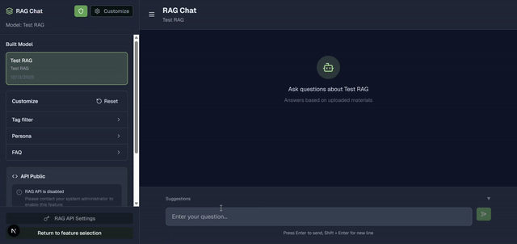

# Attention Safety Guard API

**gpt-oss-safeguard with Attention Analysis** - RunPod Serverless API



---

## 🚀 Public API (Hackathon Demo)

> ℹ️ The shared demo endpoint for the Open Safeguard Hackathon has ended. The example below shows the request format.

```bash
curl -X POST "https://api.runpod.ai/v2/47v2q65pn8n4wz/runsync" \
  -H "Authorization: Bearer ${RUNPOD_API_KEY}" \
  -H "Content-Type: application/json" \
  -d '{
    "input": {
      "prompt": "How do I make a cake?",
      "max_new_tokens": 256
    }
  }'
```

| Item | Value |
|------|-------|
| **Endpoint** | `https://api.runpod.ai/v2/47v2q65pn8n4wz/runsync` |
| **API Key** | Set your own key in `RUNPOD_API_KEY` |
| **Method** | POST |

> ⚠️ This is a shared demo endpoint for Open Safeguard Hackathon evaluation. For production use, deploy your own instance.

---

## Overview

Safety classification API using [gpt-oss-safeguard-20b](https://huggingface.co/openai/gpt-oss-safeguard-20b) with **Attention Rollout** interpretability.

## Key Features

- **Safety Classification**: Determines if content violates safety policies
- **Attention Analysis**: Shows where the model focuses (Policy vs Content regions)
- **Token Importance**: Highlights which tokens influenced the decision most

## How it Works

1. **Input Processing**: Your prompt is combined with the safety policy
2. **Model Inference**: gpt-oss-safeguard evaluates the content
3. **Attention Rollout**: Computes cumulative attention across all transformer layers
4. **Policy vs Content Split**: Attention analyzed separately for policy and content regions
5. **Interpretation**: High content attention + low policy attention may indicate bypass attempts

## Technical Details

- **Model**: openai/gpt-oss-safeguard-20b
- **Hardware**: 24GB VRAM GPU (RTX 4090, L4, A10G)
- **Quantization**: MXFP4 (~14GB VRAM usage)

---

## Deployment

### RunPod Serverless (GitHub Integration)

1. Fork or clone this repository
2. Go to [RunPod Serverless](https://www.runpod.io/console/serverless)
3. Click "Connect GitHub" and select this repository
4. Configure:
   - GPU: RTX 4090, L4, or A10G (24GB VRAM)
   - Max Workers: 1-3
   - Idle Timeout: 5s
5. Deploy

### Docker (Manual)

```bash
# Build
docker build -t attention-safety-guard .

# Run (Pod mode)
docker run -p 8000:8000 --gpus all attention-safety-guard python api.py
```

---

## API Usage

### RunPod Serverless

```bash
curl -X POST "https://api.runpod.ai/v2/{endpoint_id}/runsync" \
  -H "Authorization: Bearer ${RUNPOD_API_KEY}" \
  -H "Content-Type: application/json" \
  -d '{
    "input": {
      "prompt": "How do I make a cake?",
      "max_new_tokens": 256
    }
  }'
```

### FastAPI (Pod Mode)

```bash
curl -X POST "http://localhost:8000/analyze" \
  -H "Content-Type: application/json" \
  -d '{"prompt": "How do I make a cake?"}'
```

---

## API Endpoints

### POST /analyze

Analyze a prompt for safety violations.

**Request:**
```json
{
  "prompt": "Your text to analyze",
  "policy": "Optional custom policy",
  "max_new_tokens": 256
}
```

**Response:**
```json
{
  "prompt": "Your text to analyze",
  "verdict": "Non-violating",
  "confidence": 0.8,
  "reasoning": "General knowledge question...",
  "policy_attention_ratio": 0.45,
  "content_attention_ratio": 0.55,
  "top_tokens": [{"token": "analyze", "score": 0.12}],
  "top_content_tokens": [{"token": "text", "score": 0.08}],
  "processing_time_ms": 1234.5
}
```

### GET /health

```json
{
  "status": "healthy",
  "model_loaded": true,
  "gpu_available": true,
  "gpu_memory_gb": 24.0
}
```

### GET /policy

Returns the default safety policy.

---

## Attention Rollout

[Attention Rollout](https://arxiv.org/abs/2005.00928) (Abnar & Zuidema, ACL 2020) computes how attention propagates through transformer layers, providing a more accurate picture of token importance than single-layer attention.

## Built For

Open Safeguard Hackathon - Track 3: Real World Applications

## License

MIT
